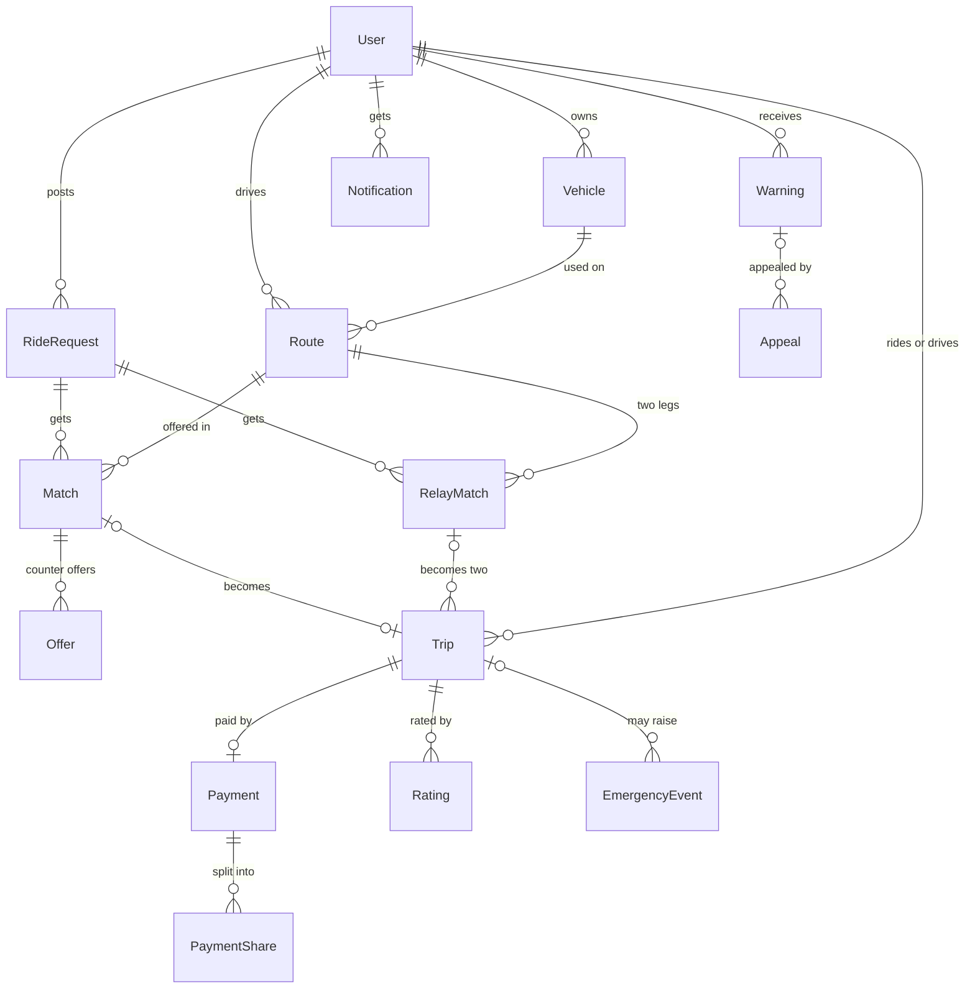
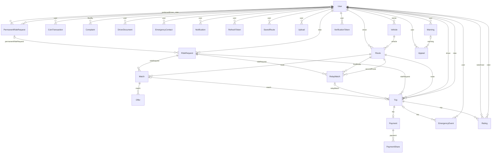

# Daigo:
- Daigo is a full stack platform built around the Next.js ecosystem, TypeScript, PostgreSQL, PostGIS, and Redis. The backend focuses on location based matching, distance calculations, dynamic pricing, and reliable request processing. PostGIS handles geospatial queries, while Redis supports caching, temporary data, and queue mechanisms for asynchronous tasks. The architecture also incorporates JWT refresh token rotation, OTP verification, real time communication through WebSockets, and payment integration with Razorpay. I’m designing the backend around clear service boundaries, efficient database queries, and dependable workflows, with attention to concurrency, request validation, and failure handling across interconnected services.
-  A carpooling app for students and office-goers. rider can post a request from to destination with App Push from that travel on that route from a different vehicle with price aggreed, and also if no single driver cover the route it can chain two driver through a relay with one transfer.
- Carpooling System for the Somethings that is shared but with key mvp features user can request their timing for the future timings
- With Key FEatures for the Affordable people to share a each other that is our key goal make a affordable.
- With a mvp also include a that real life a map system
- Where the Driver and the rider will connect and somethings unique features they cna make a multi driver for reach to the point, it's somethiing like blabla rather a Uber
- It's not a crud somethign app it's somethign have to push beyond a limit with fixing a real constraitn wher ethe two sided marktplace is think on the mapping.
- The Multi hop relay something that is a one of the intesrign feature with a path finding somethign i've look it.
- Where cold start is also a major problem which try to solve through a circled and friends which are the hard problem.
- The Pricing is a highly dynamic with baed on the diff rules.
- the geospatical matching which i'm using a raw sql which prisma doestn' support the redis pub/sub publisher and subscrieber, sender and reciever are whhere i'm sending via a websocket .
- The trust reputation sysstem with a gps spoofing, trust farming, cancellation game that i've look into it.
- Where the emergency escalation distances gated with a reliable map is a critical that can't go mistake.
- I've make sure for the verification both are acceptable the token method and the verification code method"
- The Staff account can't do a any operation from the Rider/Driver which i've not checker earlier
- 

## Tech Stack As of Now:
- Next.js
- TypeScript
- Zod
- Prisma
- Postgres
- Redis
- React.js
- 

## Database
PostgreSQL with PostGIS, accessed through Prisma. 28 tables, every id is a UUID generated by Postgres (`pgcrypto`), the staus i've added is a strict enum, route mathcing with a raw PostGIS queries.

Every relation, generated from the Prisma schema

## Something Tha I must Carefully Care:
- WE Make sure that the jsonwebtoken also must be the revokable for some user that we can suspsend based on that activity we can't just let those people to use it unless that time is expired we must have hte power to revoke that.
- With Prisma must be go with a unified folder for all the generation, schema and migration.
- With Prisma must be go with a unified folder for all the generation, schema and migration.
- With the Global Error handler we don't need to write a same try catch block every time.
- Also on the zod major issue i seee that for the not input or custom message it's not adding for that i've make my Custom Messages.
- With a Reusuable cookies we can make both refresh and teh access token content,
- Make a Bidirectional System with a User and the Vehicle
- Customized Zod Error Handler for the big value,small value smalll type rather than a default which is not good
- Make a try catch global from a error handler so we don't need every file repeated code.
-  

## I'm Working on Right Now:
- September 24: Core auth: User, EmergencyContact models; signup, login, refresh, forced-emergency-contact-form, /me routes
- @5 Start Building the Driver vehicl registration with licesnisng and the admin review system.
- Working on the Ride Request form a group request with invite by the mail with a vulnerable flag From a Matching a single driver orute overlap with a some limit from a stadia map and the postgres
- IMplementing the Matching Algorithm for people to match to the either bidirectional way.
- every trip you're on, as rider or driver
- either party, any time before completion; releases the seat back to the route and resets the ride request to PENDING so it can be matched again. Records who cancelled and an optional reason
- Initiate a Redis instance with a Upstash where also token is provided, with set only auth user can access it.
- Build a Full Auth System to the login/signup/email-verify/reset-password
- With on the our ride i also have completed the permanent ride request which can be also deleted by the rider.
- we've already done a geo tag that have already done with a postgis extension also have implemented i think pretty good.
- postgis needs a external extension setup also i'm using a raw query on that postgis due to not supported prisma as of now. 

## Feature That I Build In Flow:
- Starting with the normal auth setup where account setup, onboarding value, with the multi roles auth from a super admin to the admin to the moderator to the rider to the driver, with also verification method there where the vehicle and the license verification must be there with also the admin shell is there.
- Now the core features that i build is the new routes created by a rider with request goes to a relevent driver where the Postgres Prisma steup orm is done with also where the real time accepting system is initiate
- The Countdown which i've not yet build but i'm looking to build of 75 second timer with a driver alert is already sent. 
- The Dynamic Pricing Feature, where the otp goes to the rider with a complete trip lifecycle done from create to start routes to drop point but reveiw not done.
- The review where i again starting a prisma with can customer give a review rating
- The chat payment integration is not fully completed on the working stage with razorpay setup
- The safety and emergecy is build with send a laert with also a multi hop realy solving it with a privacy gate.
- The trust score where i'm trying to ubld myslef demo for giving a scoring a dynamic basis 
- Build the Pemanet route automation where the driver prev we've work give a priority to it.
- for vulnerbale peopel mean aged people sensitive and physical condiition or the baby give a vulnerable where give a top priority no matter what pricing to teh top rated driver.
- I'll plan to build admin analytcs just for now simple anlyyis how many register and simple 
- Need to build a dmeo console with a simulation to show to the recruiter with adding a i18n of benchmark run.

## Build:
- The other tables mostly hang off `User`: refresh tokens, verification tokens, emergency contacts, driver documents, uploads, coin transactions, saved routes, permanent requests and complaints. `OtpCode` and `Waitlist` keep a plain user or request id without a foreign key, and `Zone` and `FareRate` hold the pricing settings.

## Feature That I Will Build Earlier:
## Already Build Features:
- Auth Login/Signup/Reset Password/Email Confirmation System.
- Driver Vehicle Registeration License rc upload format check with a admin review where the limited status for the pre verification of license/vehicle.
- Regular route which are the auto posting automated with advance one of request mean one way two way with gap pre defined.
- Regular routes (auto-posting) plus advance one-off requests
- For hte ride reuqest it need a time people, luggae notes, vuln flag with prefences, and also can go a group request, it's done through a invite by email.
-  For the matching engine we see a single driver route overlpat, detour limit, suggest meeting point, which we using a postgis for the point with a stadia map for the mapping.
- I'm plan to make a real time integration system which are the coming features such as: Websocket events, big driver alert, 75 second timer for accept/reject, manual automatic accpetable, with a first accept wher the race condition is applied with verifiyng from a weebhook.
- The Pricing integration system where the range is betwen a 7 to 40  with a different vehicle diff road diff time with a demand and the hard cap with group discount it decide a pricing.
- The Otp is on the several way verification, reset, location emergency, chat and super admin.
- right now for the razorpay i'm adding a mock razorpay with a cash photo confirmation and teh admin queue for resolution.
- The emergency one time button with a admin hgih alert and the distance visible with a hidden number for resuce.
- with  a trust make a two way rating but prefer a driver with a 5 level warning suspsention.j
- The admin wil seprate a superadming and moderator as super admin everthing controlr while moderator also give a access of demo console.

### Must Build:
- Auth (bcrypt + JWT access/refresh, httpOnly cookies), forced emergency-contact form, rider/driver role switch, multi-device sessions, password reset via Brevo
- Driver vehicle registration, licence/RC upload with format check, admin review, limited status pre-verification
Regular routes (auto-posting) plus advance requests, saved routes
- Ride requests: group requests, invite-by-email, vulnerable flag with explainer
- Matching: single-driver route overlap with detour limit and suggested meeting point (Postgres + Stadia Maps)
- Real-time accept flow: WebSocket + Redis pub/sub, big driver alert, 75s countdown, manual/auto-accept, first-accept-wins

## I'm Plan To Add This Feature:
Race conditions.
Payment integrity.
Duplicate transactions.
Idempotency.
Webhook verification.
Secondary: Concurrency Control, Idempotency, Webhook Integration, Payment Gateway Integration, RBAC, CI/CDOthers: Git, Linux, Postman,
Features i can addd on my Projects:
Idemptoenty Keys, while applying to the jobs.
Create also a one routes of the popular-routes for showing most pouplar jobs.
Implement a Redis For here.
Caching Layers on the /popular-jobs 
on the resume also hav to add a engineering problems ok
Race conditions.
Payment integrity.
Duplicate transactions.
Idempotency.
Webhook verification.
Secondary: Concurrency Control, Idempotency, Webhook Integration, Payment Gateway Integration, RBAC, CI/CDOthers: Git, Linux, Postman,
Features i can addd on my Projects:
Idemptoenty Keys, while applying to the jobs.
Create also a one routes of the popular-routes for showing most pouplar jobs.
Implement a Redis For here.
Caching Layers on the /popular-jobs 
Designed direct-to-storage file upload workflow using signed URLs to reduce backend resource consumption.
Implement a token Refresh
Accont Lock
use a Redis Stream for when the expired rides or running rides event, message queue and notification worker

## Rules That i Always Reminder:
- Always always must add if're working on the some external extension on the prisma/postgres always define first the extension i'lll help us to avoid a template default conflict.
- Always handle our property to the optional property that is alsoo i keep focus on.
- The Code is something that i must write on the separation of concern method.

## Something Is Here:
- Goal is to build a Tangible, non-CRDUD, Productionize a solution where it can be scalable in the coming days.
- Flow:   A commute-sharing app with we can call a carpooling. A rider posts a request from A to B; the app pushes it to people who already travel that route, by bike, car, auto or cab. Price is agreed before the trip starts. If no single driver covers the route, DaiGo can chain two drivers through a relay with one transfer.
- Core things: 
-  Request is pushed to people already traveling that route (not wait-and-hope)
- Price agreed in chat before the trip starts (addresses hidden-charge complaints)
- Partial route overlap gets a suggested meeting point
- Multi-hop relay matching (two drivers, one transfer) as a fallback when no single driver covers the full route — works for solo riders (bike or car) and for groups, as long as the vehicle on each relay leg is a car that fits the whole group

## Project Features:

### 1 Users & roles
- One account, rider or driver role, switchable but not simultaneous
- Cold-start bootstrap: "circles"— college/office email domains get matched to each other first, before opening to the general public
- Referral system tied to the coin economy
- "Notify me when a match appears" waitlist for expired/unmatched requests

### 2. Ride requests
- Fields: from, to, time window, number of people, luggage, notes, vulnerable-person flag
- Preferences: women-only, AC-only, vulnerable-rider categories (elderly, unaccompanied children, Physical Disablity) — self-declared toggle with an explainer the user can read
- Optional vehicle-type preference
- Group requests (max 5, car capacity); can request on behalf of another person, invited by email (not phone)
- Saved routes for one-tap requests; permanent routes auto-post daily (not manual)
- Unaccompanied minors (under ~14): a parent/guardian books on their behalf; mandatory live tracking overrides the normal manual-location rule for this case; only high-trust drivers eligible
### 3. Drivers
- Full vehicle detail registration; licence & RC photo upload with digit/format-rule checks (demo-level verification, not real government ID/Aadhaar verification )
- Driver can act as a rider while their driver verification is pending; they're notified it's still pending
- Regular routes (days, time, seats, detour flexibility they set) or advance one-off trips
- Can pause a route temporarily or permanently
- Can take multiple riders per trip (up to vehicle capacity)
- "Online now" mode
- Fatigue cap: max 15 hours/day (acknowledged as unenforceable in practice, kept anyway as a personal-project design choice)
- A suspended driver's already-committed regular-route trips for that day still complete; suspension takes effect from the next day, not mid-day

### 4. Matching
- Single-driver route overlap within a detour limit, suggested meeting point (Postgres + Stadia Maps)
- Relay matching as a fallback (see 1.1); booking is automatic, no manual rider approval step; the two relay drivers can chat with each other to coordinate the handoff
- Relay edge case: if the first driver runs late, the second-leg driver is notified and can choose to continue waiting or cancel; the late first driver takes a small trust-score penalty
- Relay pricing: same cost as a direct single-driver match, no transfer premium
- First-accept-wins among matched drivers
- Driver privacy: driver sees only the rider's first name and reviews until within a 10 km radius (masked before that); rider sees the driver's full public profile, photo and vehicle; driver's photo is revealed to the rider only within 3 km; phone numbers stay hidden until close
- 75-second accept window, countdown shown per second on the client (75, 74, 73…); driver gets a sound-based big-UI alert
- Manual or auto-accept option for drivers
- If unmatched: rider can retry, raise the price, or accept a flexible meeting point
- Return-trip auto-suggestion after a completed trip, prioritizing the same driver before opening to others
- Vehicle capacity is enforced (max 5/car); if no match fits the full group, the rider can reduce the requested party size to find a match

### 5. Pricing
- Base rate ₹7–40/km, varies by vehicle type
- Per-zone multiplier: ~100 simple lat/long grid zones across the 4-state pilot region, each zone storing its own multiplier directly (folds in village/city and terrain together,  hill-terrain zones start at 1.5x, plains zones at 1.0x, both manually adjustable later)
- Time-of-day bands: office hours and night priced a little higher
- Weather input via OpenWeatherMap feeding into the dynamic price
- Demand multiplier: open requests vs. online drivers in the area, using a high/low threshold system (not a simple fixed ratio)
- Two hard caps (a per-km ceiling and an absolute ceiling); calculations use raw float precision internally but the final price is rounded to a whole rupee — caps must be checked against the rounded value, not the raw float, so a rounded price can never land just over the cap
- Group rides: one person pays by default; optional split if other members have accounts; non-account members can be invited and pay later (mock Razorpay only)
- Price estimate shown to the rider at request-creation time, before the 75s wait
- Full breakdown always visible; drivers who try to charge over the caps get warnings

### 6. Trip lifecycle
- Dedicated "confirmed trip" screen after a match, showing driver details
- Pickup OTP sent by email and also shown in-app (quick access at pickup)
- Location sharing is manual (not automatic pings every few minutes — decided against as impractical)
- In-trip chat lives in Redis, cleared after the trip finishes but kept until the rating/review for that trip is submitted; chat closes (with a clear confirmation) after the trip
- Payments: online (Mock as of now but later on done from razorpay) auto-marks paid; cash requires the driver to upload a completion/delivery photo to mark it paid; a payment mismatch goes to an admin complaint queue

### 7. Cancellations & no-shows
- Driver cancellation: graduated penalty — canceling early causes little/no damage, canceling late causes more damage but capped (not severe)
- Rider cancellation after a confirmed match (not a no-show): a real, high penalty like the driver's, not penalty-free — but the rider can appeal
- No-show (rider never appears, never explicitly cancels): trust-neutral for the rider; an honest no-show with an explicit reason can slightly increase their score

### 8. Safety
- One mandatory emergency contact required via a forced form right after signup (name + primary number); user has the option to add more
- Emergency button: automatically grabs a one-time location, sends a high-alert email (Brevo) plus a live WebSocket push to the admin dashboard, and emails the user's emergency contact
- Ad-hoc one-tap "share my live trip" link, separate from the mandatory emergency contact, scoped to that one trip only
- Distance-gated visibility as in 1.5

### 9. Trust & ratings
- Trust score is a cached number on the user's row, recalculated asynchronously
- Unjustified rider reports of a driver arriving late are treated as a major risk signal and lower that driver's score, which feeds future match priority
- Two-way star rating plus written review, plus a one-click "highly recommend this driver" tag by reason (e.g. conversation, driving skill)
- 5 warnings → suspension; users can appeal through an internal support system that includes an AI assistant answering queries from DaiGo's own data
- New users are very limited until they complete a few trips
- Abuse countermeasures: GPS-spoofing and cancellation-gaming get dedicated countermeasures; trust-farming (reciprocal fake-trip score inflation) gets only a rate cap on trust-score gain, treated as an acknowledged, documented limitation rather than a built countermeasure

### 10. Coins & referral
- Coins earned through activity, redeemable for a discount on a future ride
- Redemption: 500 coins required, discount capped at ₹50; user is notified what % they currently qualify for
- Referral system tied to the coin economy

### 11. Admin
- Super admin (full privileges, extra email verification required on every login) and moderator (limited access) roles
- Emergencies show up live via WebSocket in addition to the Brevo email alert
- Complaint records carry a visible status flow: open → in review → resolved / rejected (resolution itself is manual "contact support" for now, not automated)
- CSV export: 30-day window by default, with a custom date range option; heavy/custom exports run through a background job (see Infrastructure) rather than blocking a request

## Pretty Impressive FEatures That i Build Over Time: (Build All this Featuree at 20 October)
### Relay Matching: 
  - Two drivers are chained through a walkable transfer point, and the trip only commits when both drivers accept, in one transaction. with the like a flight search for multiple stop points.
### Concurrency-safe live accept:
  - For the Support of the conurrecnly the first accept win's automatily with teh 75 second expirary from the server leevel.
  - Each Events is always go thorugh the redis: `pub/sub` from a vercel websocket (vercel websocket still not suported with i've to fix) for now the polling is our fallback option. With the 100 parallel accept on the exactly one trip i plan too show on the  demo conosle.
### Pricing Engine:
  - It involve a multiple of things such as: `zones, weather, global demand with a hysteresis, IST time, caps value, vehicle range type`
### Trust and abuse resistance:
  - Trying to Detect a GPS Spoof which some bad user can try with a route deviation alerting, and the cancellation gaming detecntion with the 90 days warning cycle for the warning appeal. 
## Demo Console:
    - For the Backend Things rather than showing step by step it's the somthing a demo consle key feature will trigger at once and show the number.
      - with like `1000` request simoltation like this

## Future Feature That I'm Plan to Build:
- Route-deviation alert if the driver's live location drifts far off the expected route 
- Dashboard: graphs of everything in the database (trips over time, money saved, active drivers, emergency triggers, coin redemptions, stats)

### This is Just For My Recruiter Purpose:
- Demo console: I'm plan to can trigger every major feature on demand (a concurrent-accept race, an emergency, a demand spike, a relay with its full data flow, a cancellation penalty, etc.) For Showing to the Other People admin can also manually force a stuck scenario forward (e.g. force-assign a driver)
- Simulated-data seeding for the benchmark: ~100 seeded entities, with an option to reset the seed data