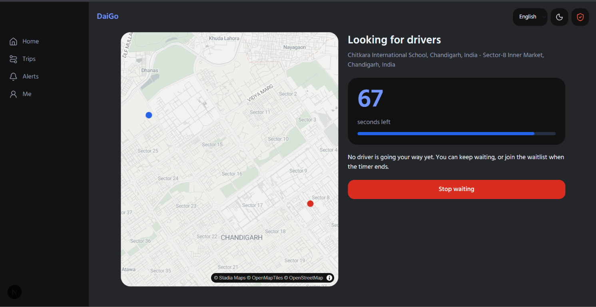
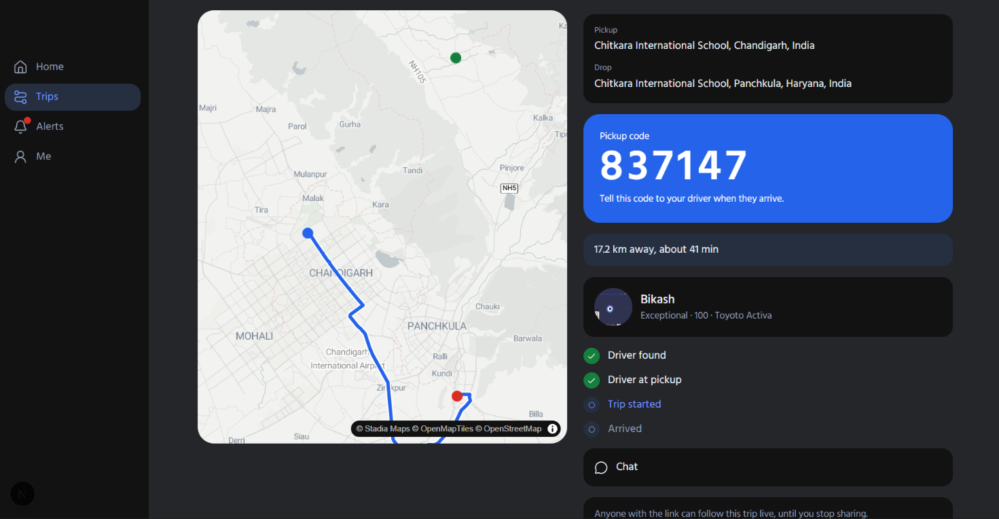
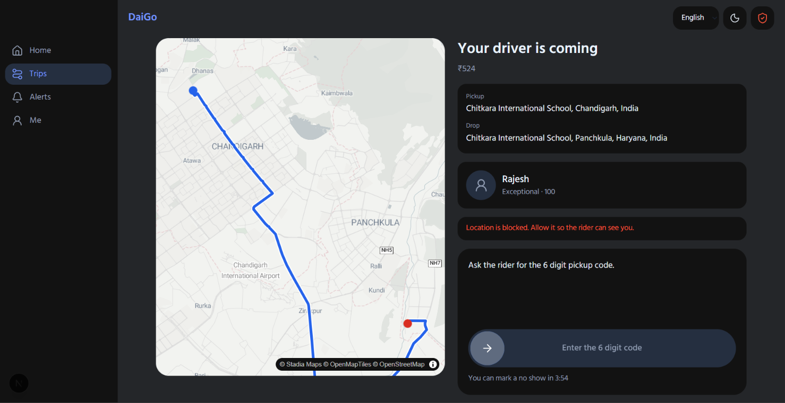
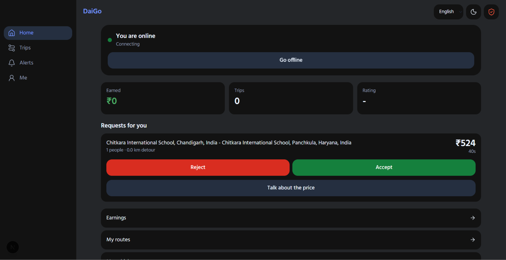
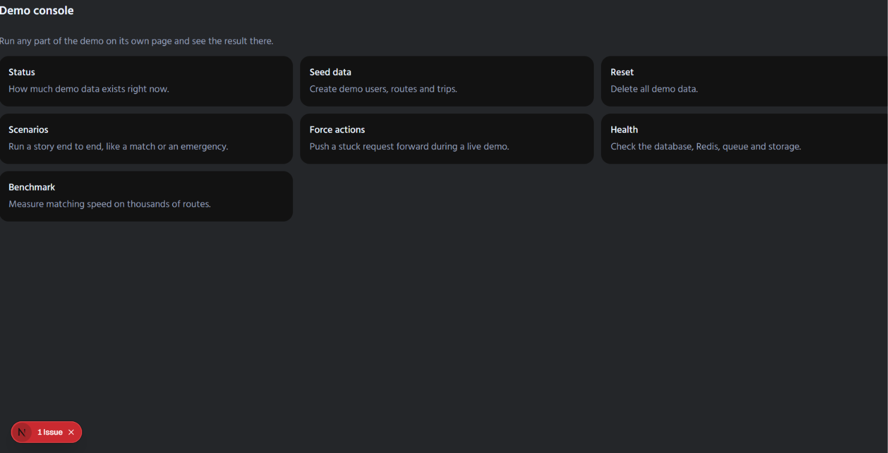
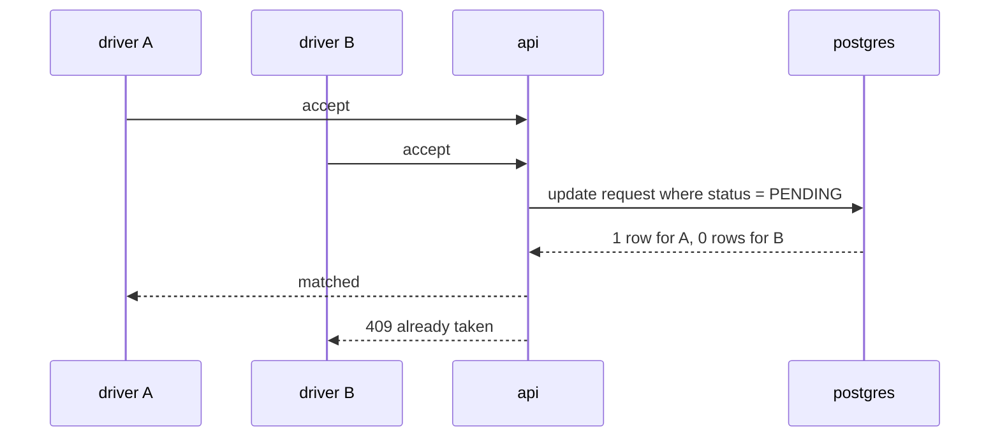
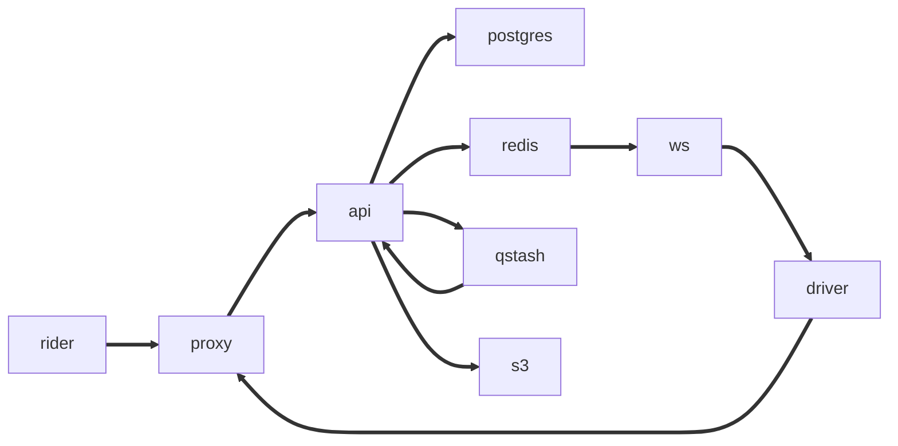
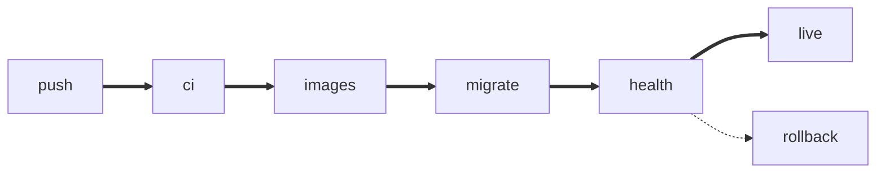
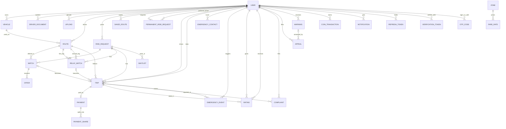

<picture><source media="(prefers-color-scheme: dark)" srcset="docs/logo_dark.svg"></picture>

<p>
<a href="#overview">Overview</a> |
<a href="#demo-url-and-console">Demo</a> |
<a href="#key-highlights">Highlights</a> |
<a href="#architecture-overview">Architecture</a> |
<a href="#installation--setup">Install</a> |
<a href="#reliability">Reliability</a> |
<a href="docs/decisions.md">Docs</a>
</p>

# DaiGo

Share the Road, Split the Cost. A commute sharing platform where a rider's request is pushed to people already driving that way, and two drivers are chained into a relay when nobody covers the whole trip.

[](https://daigo.dipsharma.me)
[](https://github.com/tech-dipesh/daigo/actions/workflows/ci.yml)
[](https://github.com/tech-dipesh/daigo/actions/workflows/deploy.yml)
[](https://github.com/tech-dipesh/daigo/commits/main)

<p>



</p>
<p>



</p>

## Table of Contents

1. [Overview](#overview)
2. [Demo URL and Console](#demo-url-and-console)
3. [Key Highlights](#key-highlights)
4. [Tech Stack](#tech-stack)
5. [Architecture Overview](#architecture-overview)
6. [Installation & Setup](#installation--setup)
7. [Deployment](#deployment)
8. [Database Design](#database-design)
9. [Features](#features)
10. [Security](#security)
11. [Reliability](#reliability)
12. [Development Rules](#development-rules)
13. [Project Status](#project-status)
14. [Challenges & Learnings](#challenges--learnings)
15. [Limitations](#limitations)
16. [Future Improvements](#future-improvements)

## Overview

A rider posts where they are going. The app finds people who already drive that way, by bike, scooter, car, auto or cab, and tells them. If nobody covers the whole trip, it chains two drivers into a relay with one handover. The price is shown before the ride, with a plain breakdown and two hard caps, and no payment is taken in the app beyond a test gateway.

- Goal: a tangible, non-CRUD, production-style solution that can grow
  - not a simple CRUD app: it solves a real two-sided marketplace problem and is built around a map
  - made for students and office-goers, with affordability as the key goal
  - closer to BlaBlaCar than Uber: drivers and riders connect, and several drivers can chain together to reach one point
- Flow: a rider posts a request from A to B, and the app pushes it to people who already travel that route. The price is agreed before the trip starts. If no single driver covers the route, DaiGo can chain two drivers through a relay with one transfer.
- Core things
  - the request is pushed to people already travelling that way, not wait-and-hope
  - the price is shown up front and can be negotiated in a short offer window before the trip is locked, which addresses hidden-charge complaints
  - partial route overlap gets a suggested meeting point
  - multi-hop relay matching (two drivers, one transfer) is a fallback when no single driver covers the full route. It works for solo riders and for groups, as long as the vehicle on each leg is a car that fits the whole group
  - riders can request a future time, not only an immediate ride
- Cold start is the major problem of any two-sided marketplace. DaiGo tackles it with "circles" (people on the same college or office email domain are matched first), a waitlist that tells you when a match appears, and weekday rides that post themselves

## Demo URL and Console

- Live site: [daigo.dipsharma.me](https://daigo.dipsharma.me)
- Health: [/api/v1/health](https://daigo.dipsharma.me/api/v1/health) checks Postgres and Redis and is what the status badge reads
- Demo console (`/admin/demo`, staff only): built to show a recruiter the backend without stepping through it by hand
  - seed: fills the app with demo users, drivers, routes and trips (full or quick), and reset wipes only demo data
  - scenarios: one trigger runs a whole flow and prints a pass or fail line for every check
    - normal match
    - no driver
    - double accept: two drivers accept the same request at the same moment and exactly one wins
    - emergency
    - cancel after accept
    - payment mismatch
    - vulnerable request
  - force tools: assign a driver to a stuck request, expire a request, mark a driver as arrived, so a demo never stalls waiting on real matching
  - health: database, Redis and queue status in one place
  - benchmark: runs the matching query on 20,000 generated routes with the spatial index and with a plain scan, and shows the EXPLAIN plan and timing for both
  - moderators can use it too
- Demo accounts live on one email domain and never send real mail, so the console cannot touch real users

## Key Highlights

### Concurrency-safe accept

- The accept is one database transaction with guarded updates: the request moves from PENDING to MATCHED only if it is still PENDING, and seats only drop if enough are left
- The loser of a race gets a clean 409 and nothing is half written, no lock or queue needed
- Matches expire on the server, and the 75-second countdown on the client is driven by the server timestamp so every screen shows the same number



### Relay matching

- When no single driver covers the trip, the engine looks for two routes whose ends meet within 3 km of a handover point, like a flight search with a stop
- The relay only commits when both drivers accept, in one transaction. Until then each driver sees only their own half in a relay inbox, and the two drivers can chat to agree the handover
- If the first driver runs late, the second driver is told and can keep waiting or cancel, and the late driver loses a little trust
- Direct matches always come first, and the price is the same as a direct trip with no transfer premium

### Geospatial matching with raw PostGIS

- Prisma cannot express "within X metres of a route", so matching is raw SQL with typed results
- The demo console benchmark compares the indexed query with a plain scan so the index claim can be checked instead of trusted

### Real-time that survives a bad network

- Events go through Redis pub/sub to a Bun websocket server, so any api instance can reach any connected driver
- If the socket drops, the client falls back to polling, and a driver in fallback keeps a presence beat going every 30 seconds so they still show as online
- The driver alert is a full screen takeover with a siren and a countdown, and the nav shows an unread dot for new notifications

### Pricing engine

- A rate per km by vehicle (7 to 40), times a zone multiplier (hill terrain starts at 1.5, plains at 1.0), time of day, weather from OpenWeatherMap, group discount and a demand multiplier
- Demand has two thresholds so the price does not flicker: it turns busy when open requests reach twice the online drivers and turns calm only when the ratio falls to 1
- Two hard caps: a per km ceiling and an absolute ceiling. The rupee value is rounded first and capped after, so rounding can never push a fare over the cap
- The rider sees the full breakdown and an estimate before the request is sent

### Trust, safety and abuse resistance

- Distance-gated privacy: the driver sees the rider's first name and reviews, then more only within 10 km, and the rider sees the driver's photo only within 3 km. It is checked on the server, so the data is never sent early
- Emergency button: grabs one location, emails the contact and the admin, and shows live on the admin dashboard
- Guardian-booked rides for children (13 and under) go only to drivers with trust 90 or more and at least 10 completed trips, with mandatory live location and a small premium
- GPS spoof detection flags a jump faster than 150 km/h, and cancellation gaming flags 3 cancellations in 24 hours. Both give a warning
- 5 warnings inside a 90 day cycle (at most 2 a day) means a permanent ban, with an appeal flow

### Retries that never charge twice

- Risky POST routes (payments, split payments, ride requests, retries, saved route requests) accept an Idempotency-Key held in Redis for 24 hours
- Same key and same body replays the first answer, same key with a different body is rejected with a 422

## Tech Stack

- Web and API
  - Next.js and TypeScript in strict mode, web app and api in one project
  - Redux Toolkit with RTK Query for client state, API caching and error mapping
  - next-intl: English, Nepali and Hindi, controlled with a cookie
  - Tailwind CSS v4 and a custom UI with no component library
    - slide to confirm control for booking and login
    - six box OTP input
    - lazy loaded MapLibre map that follows the system theme
- Data
  - Prisma 7.10.0 and Postgres with PostGIS and pgcrypto
  - Zod 4.6.5 validation on every request
  - Upstash Redis and QStash: rate limits, pub/sub, chat, idempotency, background jobs
- Maps and weather
  - Stadia Maps and MapLibre: map, search and routing
  - OpenWeatherMap: weather input for pricing
- Files, email and payments
  - AWS S3: licence, RC, profile and payment proof photos, only through short lived signed links
  - Brevo: transactional email
  - Mock payment gateway for now
- Runtime and delivery
  - Node 26.13.1 and pnpm 12.21.0, pinned in package.json
  - Bun and ws: the websocket server
  - Docker Compose and Caddy on one EC2 box
  - GitHub Actions: lint, type, build, deploy
- Installable as an app: web manifest, icons and a small service worker that shows an offline page

## Architecture Overview



- Strict separation of concerns so the codebase stays testable. The backend has four layers
  - Route handlers: thin Next.js routes that only deal with the request and the response
  - Validation: centralized Zod schemas with one custom error formatter that turns issues into human messages
  - Services: the business logic (trips, payments, trust, matching), including transactions and idempotency
  - Repositories: every Prisma and SQL call lives here, so ORM and SQL stay out of business logic
- `proxy.ts` runs before every request: it rate limits by IP, checks the JWT, and silently renews the access token from the refresh token so a user stays signed in for the whole refresh period
- One global error wrapper (`withErrorHandling`) and one response shape for every route: `{ success, data, error }`
- Real-time: events go through Redis pub/sub to the Bun websocket server on the same box, with polling as the fallback
- Background jobs: QStash calls back a signed endpoint for CSV exports, the daily weekday ride auto-post and slow email work, so a request never waits on them
- Direct-to-storage uploads: the api validates type and size, signs a short lived URL, and the browser uploads straight to S3, so large files never use server memory
- Offer window: once a driver is matched, a 5 minute window opens for up to 3 rounds of price offers between 0.8x and 1.3x of the estimate, and the last round can go up to the hard cap
- Driver auto-accept: a driver can set a minimum price, a minimum per km and a minimum rider trust, and the system accepts on their behalf using the same guarded accept as a manual tap
- Relay fallback: when no direct match exists, PostGIS narrows candidates and the relay engine pairs routes that meet around a handover point

## Installation & Setup

```bash
pn i && cp .env.example .env && pn generate
```

```bash
pn dev
```

Fill `.env` first. Every key is checked when the server starts, and if one is missing or invalid it stops and prints which key.

- Database and auth: `DB_URL`, `DIRECT_URL`, `ACCESS_TOKEN_SECRET`, `REFRESH_TOKEN_SECRET`
- Redis and jobs: `UPSTASH_REDIS_REST_URL`, `UPSTASH_REDIS_REST_TOKEN`, `QTASH_TOKEN`, `QTASH_CURRENT`, `QTASH_NEXT`
- Email: `BREVO_API_KEY`, `BREVO_FROM_EMAIL`
- Maps and weather: `STADIA_API`, `NEXT_PUBLIC_STADIA_API`, `OWM_KEY`
- Storage: `S3_URL`, `S3_BUCKET`, `S3_REGION`, `S3_KEY`, `S3_SECRET`
- App: `APP_URL`, `DEMO_MODE`, `DEMO_LIVE_EMAIL`
- Scripts: `pn dev`, `pn build`, `pn lint`, `pn type`, `pn generate`, `pn migrate`

## Deployment



- CI runs lint, type and build on Node 26.13.1
- A deploy builds three images in parallel: the app, the websocket server and a one-shot migrate image
- On the server: start the database, run `prisma migrate deploy`, start everything and wait for the health checks, then call the health route through Caddy
- If anything is unhealthy it goes back to the last good image tag by itself, and `scripts/rollback.sh` does the same by hand. Database migrations are not undone, so each one has to stay backwards compatible
- Caddy terminates TLS, adds the security headers and proxies the websocket path to the Bun server
- The app container runs as a non-root user, and logs rotate so the disk does not fill

## Database Design

PostgreSQL with PostGIS, accessed through Prisma. 28 tables plus `export_jobs`, every ID is a UUID generated by Postgres (`pgcrypto`), statuses are strict enums, timestamps are timestamptz shown in IST, and route matching is done with raw PostGIS queries. Money fields are rounded to whole rupees and caps are checked on the rounded value. Chat lives in Redis, so it is not in the diagram.

- PostGIS is an external extension that Prisma does not model, so geo queries are raw SQL and the extension is declared first in the schema
- Most tables hang off `User`: refresh tokens, verification tokens, emergency contacts, driver documents, uploads, coin transactions, saved routes, permanent requests and complaints
- `OtpCode`, `Waitlist` and `ExportJob` keep a plain user or request id without a foreign key
- `Zone` and `FareRate` hold the pricing settings, and the admin can edit both
- Soft delete: user accounts are soft deleted. Deleting an account revokes every refresh token and cancels active trips, and the data is kept for audit without breaking foreign keys
- Duplicate data is stopped in the database with unique constraints, and the global handler turns a violation into a clean 409

<details>
<summary>Every relation</summary>



</details>

## Features

### 1. Users & roles

- One account, rider or driver role, switchable but never both at once. A new account starts as a rider and a first switch to driver opens the vehicle and licence onboarding
- Roles: super admin, moderator, rider, driver. Staff accounts cannot do any rider or driver action
- Sign up with email and password, then a six digit email code (or the emailed link) verifies the account. Verification gates every write action
- Forced emergency contact form right after signup (name and primary number, email optional and addable later)
- Password reset by emailed link, and the reset signs the user out of every device
- Multi-device sessions: access token in 15 minutes, refresh token for 30 days, silently renewed
- Cold-start bootstrap: "circles", where people on the same non-public email domain match each other first, before the general public
- A waitlist for unmatched requests: DaiGo tells you when a match appears, and the Matched tab lets you search again in one tap
- Profile with photo (with a loader while it fetches), trust score, written reviews from past rides, language, and an install card for the app

### 2. Ride requests

- Fields: from, to, time window, number of people, luggage, notes, vulnerable-person flag
- Preferences
  - women only, AC only
  - vulnerable rider categories (elderly, unaccompanied child, physical disability), a self-declared toggle with an explainer the user can read
  - optional vehicle type
- Vulnerable riders are only offered drivers with trust 75 or more, no matter the price
- Group requests
  - up to 5 people, limited by vehicle capacity
  - can request for another person, invited by email (not phone)
- Saved routes for one tap requests
- Weekday rides post themselves each morning. A rider can pick a preferred driver, but only from drivers they have actually ridden with before and not rated 2 or lower, and the option is hidden if there are none
- Return ride: after a completed trip, a card offers the same driver's route back and requests the reverse trip in one tap
- Guardian rides: a parent or guardian books for a child aged 13 or under. Only high-trust drivers are eligible, live location is mandatory, and a small premium applies

### 3. Drivers

- Full vehicle registration, licence and RC photo upload with format checks (demo-level, not government verification), then admin review. Until approved the driver can still act as a rider and is told it is pending
- Regular routes (days, time, seats, detour they accept) or advance one-off trips, with pause and resume
- Several riders per trip, up to vehicle capacity
- "Online now" mode, with a presence beat if the websocket is down
- Auto-accept with a minimum price, minimum per km and minimum rider trust
- Relay inbox: relay offers show next to direct requests, with accept or reject and a chat with the other driver
- Earnings and trip dashboards, and manage or re-upload vehicles and documents
- A suspended driver's already committed trips for that day still complete, and the suspension starts the next day

### 4. Matching

- Single-driver route overlap within a detour limit, with a suggested meeting point (PostGIS and Stadia Maps), respecting the route's days and departure time
- Circles first, then everyone else
- Relay matching as a fallback (see Key Highlights)
- First-accept-wins among matched drivers
  - 75 second accept window, counted down per second on the client
  - the driver gets a sound-based full screen alert, and can accept manually or through auto-accept
- Driver privacy and distance-gated visibility
  - within 10 km the driver sees more of the rider, before that only the first name and reviews
  - the rider sees the driver's public profile and vehicle, and the driver's photo only within 3 km
  - phone numbers stay hidden until close
- If unmatched, the rider can retry, raise the price, accept a flexible meeting point, or join the waitlist
- Vehicle capacity is enforced, and if nothing fits the whole group the rider can reduce the party size

### 5. Pricing

- Base rate per km by vehicle type, between 7 and 40, editable by the admin
- Per-zone multiplier: about 100 grid zones across the pilot region, each storing its own multiplier directly (village, city and terrain folded into one number, hills start at 1.5)
- Time-of-day bands: office hours and night are priced a little higher
- Weather input from OpenWeatherMap
- Demand multiplier with two thresholds so the price does not flicker
- Two hard caps, a per km ceiling and an absolute ceiling. Math runs in floats, the price is rounded to a whole rupee, and the cap is applied to the rounded value. Drivers who try to charge over the caps get a warning
- Group rides: one person pays by default, and can split by sending links. A friend can pay their share through a link without an account
- The estimate is shown before the request is sent, and the full breakdown is always visible
- After a trip DaiGo shows money saved compared with a solo cab for the same distance

### 6. Trip lifecycle

- A confirmed trip screen after the match with the driver details
- Pickup code sent to the rider by email and also shown in the app
- Live location shared by the driver, with distance and an ETA, and the same view lets a relay's second driver watch the first driver approach the handover
- Location is shared by the user, not tracked in the background
- Trip share link: one tap gives a public link for that one trip, so a friend can follow it
- In-trip chat in Redis, kept until the rating is submitted and then cleared
- Payments
  - online (mock gateway) marks the trip paid at once
  - cash needs the driver to upload a photo as proof before it counts as paid
  - a payment mismatch goes to an admin complaint queue
- Ratings: stars, a written review, and a one click "recommend" tag with a reason, in both directions

### 7. Cancellations & no-shows

- Either side can cancel before completion. The seat goes back to the route and the request returns to PENDING so it can be matched again
- Driver cancellation has a graduated penalty: little for early, more for late, but capped
- Rider cancellation after a confirmed match has a real penalty too, and the rider can appeal
- No-show: the driver waits out a timer and then marks it. A no-show does not hurt the rider's trust, and an honest reason can even help it

### 8. Safety

- One mandatory emergency contact, more can be added
- Emergency button
  - works from any trip and from the public emergency page
  - takes a one-time location
  - emails the emergency contact and the admins, and appears live on the admin dashboard
  - the page also offers a call to 112
- Trip share link, separate from the emergency contact
- Distance-gated visibility, as in Matching
- Route deviation: a driver more than 2 km off the straight line between the route ends is flagged (a simple approximation for now)
- GPS spoof check: two location points that imply more than 150 km/h flag the trip

### 9. Trust & ratings

- Trust score is a cached number on the user, starting at 100 and clamped between 0 and 100
- Ratings move the score: five stars add a little, one star takes more away
- A late-arrival report against a driver counts against them, so reports feed future match priority
- Warnings come from three reasons: GPS spoofing, cancellation gaming and charging over the cap. At most 2 a day, and 5 inside a fixed 90 day cycle means a permanent ban. Users can file an appeal, and admins decide it
- New users are limited until they finish a few trips
- Trust farming (two accounts boosting each other) is a known limitation, listed under Limitations

### 10. Coins

- 10 coins for every completed trip, for rider and driver
- 500 coins give 50 rupees off a payment, and the app tells the user how close they are
- Coins are written inside the same transaction as the trip or payment, so they cannot drift

### 11. Admin

- Super admin (extra emailed login code every time) and moderator with limited access, who can also use the demo console
- Dashboard graphs: trips over time, money saved, active drivers, emergencies and coin redemptions, plus user search and detail
- Verification queue for vehicles and licences with approve, reject and reason
- Live emergencies over the websocket, in addition to the email
- Complaints and appeals with a visible status flow: open, in review, resolved or rejected
- Zones and fare rates editable in place
- CSV exports for trips, users and complaints with a default 30 day window and a custom range. They run as a background job, show Queued, Running, Ready or Failed in a history list, and give a fresh download link on each load
- Background job buttons: run the weekday auto-post now, or schedule it for 6am every day

### 12. Languages and app shell

- English, Hindi and Nepali with a cookie, and a short in-app tutorial route with a guided tour
- Mobile first, responsive from 320px, big tap targets on touch screens, and keyboard friendly
- Installable as an app, with an offline page when the network is gone

## Security

- Authentication
  - bcrypt for passwords, JWT access and refresh tokens in httpOnly, secure cookies set by one reusable helper
  - refresh tokens are stored hashed and rotate on every use. A password reset or an account deletion revokes all of them
  - OTP codes allow 5 attempts: email verification, password reset, super admin login
- Authorization
  - roles checked in one place for every route, and staff accounts cannot act as rider or driver
  - super admin needs an emailed code on every login
- Validation
  - every input goes through Zod with custom messages, and the same schemas run on the server for body, params and query
- Privacy
  - distance-gated visibility of names, photos and phone numbers
  - hidden phone number for rescue in emergencies
- Uploads only through short lived signed URLs, with the type and size checked first
- Rate limiting: 60 requests a minute per IP in the proxy
- Security headers at Caddy: HSTS, nosniff, referrer policy and a permissions policy
- Webhook safety: background job calls are verified with the QStash signature before anything runs
- Abuse resistance: see Key Highlights
- Route deviation: it already flags a driver more than 2 km off the straight line between the route ends, and it adds an admin text. It has no road-based check and nothing is shown to the rider.
Payments: the gateway is a mock that returns mock_<uuid> instantly.
Expiry: requests only expire by a timestamp check. Nothing emits an "expired" or "running" event, and no worker reads events.
Background jobs: four QStash jobs (email, notification save, weekday auto-post, CSV export), with no dead-letter handling.
Security headers: Caddy sends HSTS and a few more, but no CSP.
Your jobs ideas: these describe Yeti Jobs, a different repo. In DaiGo, idempotency keys and signed S3 uploads are already built. The only one that doesn't exist here is the popular-endpoint-with-Redis-cache idea.

## Reliability

Done

- Idempotency keys on risky POST routes, kept 24 hours in Redis
- Signed webhook verification for background jobs
- Rate limiting per IP and capped OTP attempts
- Revocable tokens with rotation
- Atomic transactions with guarded updates for accept, relay confirm, cancel, payment and coins
- Enums and unique constraints for strict data
- Health checks, migrate before start, wait for healthy, automatic and manual rollback

Missing (written down on purpose, see [docs/reliability.md](docs/reliability.md))

- Automated tests
- Real payment webhooks and reconciliation
- Per-user and per-route rate limits
- Account lock after wrong passwords
- A dead-letter queue for failed jobs
- Metrics, alerts and central logs
- Automated database backups
- A content security policy

## Development Rules

- Prisma: one folder for the schema, migrations and generated client, and the client file is `db.ts`
- External Prisma/Postgres extensions (like PostGIS) are always declared first
- TypeScript strict mode, no `any`, aliases with `@`, and raw SQL results get explicit types
- Errors: one global handler, so try/catch is not repeated in every file
- Zod: always a custom message, `z.email()` and `z.flattenError()`
- Cookies: one reusable helper for both tokens
- Routes stay thin: validation, services and repositories are separate layers
- DRY once the same code repeats more than three times, not before
- Optional chaining with a fallback for data that can really be missing
- One response shape for every route: `{ success, data, error }`
- Short names and single-line operations, and no blank lines inside functions

## Project Status

### Built

- Auth: signup, login, silent refresh, email verification, password reset, forced emergency contact, role switch, multi-device sessions
- Driver onboarding: vehicles, licence and RC upload with format check, admin review, limited status until approved
- Routes and requests: regular and advance routes, saved routes, weekday rides, groups, invite by email, vulnerable flag, preferences, waitlist, return ride
- Matching: PostGIS single-driver matching with detour and schedule checks, circles, relay fallback with inbox and chat, suggested meeting point
- Realtime: websocket plus Redis pub/sub, full screen driver alert, 75 second countdown, manual and auto accept, first-accept-wins, polling fallback and presence beat
- Pricing: zones, time, weather, demand with thresholds, two caps, group discount, offer window, estimate and breakdown
- Trips: pickup code, live location and ETA, chat, share link, cancel, no-show, complete, payments (mock online and cash with proof, split links), ratings and reviews
- Safety: emergency button with one-time location, admin live alert, distance-gated visibility, deviation and GPS spoof checks, guardian rides
- Trust: cached score, warnings, 90 day cycle, ban and appeals, coins
- Admin: roles, verification queue, emergencies, complaints, appeals, zones, fares, analytics, exports with history, background job controls, demo console with seed, scenarios, force tools, health and benchmark
- Delivery: Docker, Caddy, CI, deploy with migrate, health checks and rollback, installable app with an offline page
- Languages: English, Hindi, Nepali

### In progress

- Native speaker proofreading of the Hindi and Nepali text
- Real screenshots and measured benchmark numbers for this README

## Challenges & Learnings

- Engineering problems targeted
  - race conditions
  - payment integrity
  - duplicate transactions
  - idempotency
  - webhook verification
- Secondary: concurrency control, geospatial SQL, websocket scaling with pub/sub, payment flows, RBAC, CI/CD, Docker, Linux, Postman
- Cold start of a two-sided marketplace, tackled with circles, a waitlist and weekday rides
- Geospatial matching needs raw SQL because Prisma does not model PostGIS
- Redis pub/sub between a publisher in the api and a subscriber in a separate websocket process, delivered over a socket
- A websocket cannot run on a serverless function, so it runs as its own small process on the EC2 box
- Auditing the finished API against the UI found real gaps: relay offers were created but never alerted to the drivers, and the emergency button only showed a phone link. An API route with no screen is a missing feature, so the audit is now part of the checklist
- Small details are the bugs: a fare that rounds over its cap, a cached image that never fires its load event, a one-shot migration that must run before the app starts

## Limitations

- Payments are a mock gateway
- Licence and RC checks are format checks plus admin review, not government verification
- Location is shared by the user, not tracked in the background
- Route deviation uses a straight line, not the real road
- Trust farming has no countermeasure yet
- There are no automated tests, so correctness rests on the demo console scenarios
- One server, so no failover, and no automated backups
- Mapped for a few regions of north India only
- Real payment gateway with webhooks and reconciliation
- A Redis Stream queue with a notification worker and dead letters

## Future Improvements
- Automated tests for pricing, matching and cancellation penalties
- Road-based route deviation using the routing service
- Per-user rate limits and an account lock after repeated failures
- Metrics, alerts and database backups
- A demo console scenario for relay matching
- A native app shell for background location

Thanks for reading, and if you try it and something breaks, please tell me.
# :)