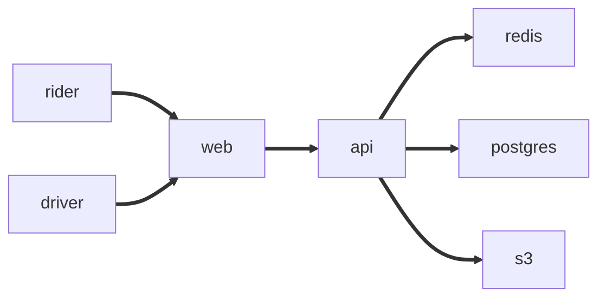
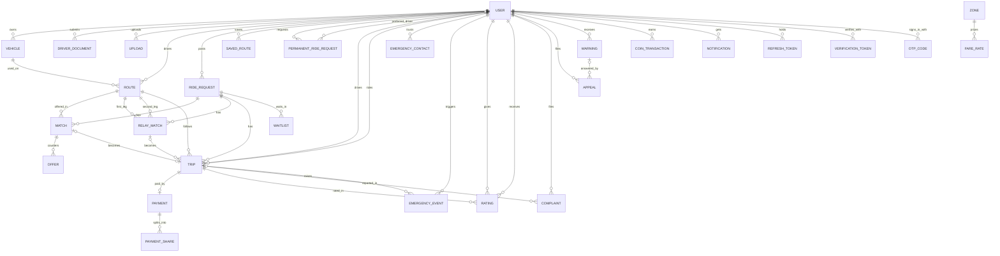

<picture><source media="(prefers-color-scheme: dark)" srcset="docs/logo_dark.svg"></picture>

# DaiGo

[](https://daigo.dipsharma.me)
[](https://github.com/tech-dipesh/daigo/actions/workflows/deploy.yml)

## Table of Contents:

1. [Overview](#overview)
2. [Demo URL and Console](#demo-url-and-console)
3. [Tech Stack](#tech-stack)
4. [Architecture Overview](#architecture-overview)
5. [Installation & Setup](#installation--setup)
6. [Database Design](#database-design)
7. [Features](#features)
8. [Key Highlights](#key-highlights)
9. [Security](#security)
10. [Development Rules](#development-rules)
11. [Project Status](#project-status)
12. [Challenges & Learnings](#challenges--learnings)
13. [Limitations](#limitations)
14. [Future Improvements](#future-improvements)

## Overview

A rider posts where they are going. The app finds people who already drive that way, by bike, car, auto or cab, and tells them. If nobody covers the whole trip, it chains two drivers into a relay with one handover. The price is shown before the ride, with a plain breakdown and two hard caps, and no payment is taken in the app beyond a test gateway.

Share the Road, Split the Cost. A commute sharing platform built only for 3 mapped regions.

- Goal: a tangible, non-CRUD, production-ready solution that can scale in the coming days
  - not a simple CRUD app: it pushes beyond that by solving a real two-sided marketplace constraint, built around mapping
  - made for students and office-goers, with affordability as the key goal
  - closer to BlaBlaCar than Uber: drivers and riders connect, and several drivers can chain together to reach one point
- Flow: a commute-sharing app, or carpooling. A rider posts a request from A to B, and the app pushes it to people who already travel that route, by bike, car, auto or cab. Price is agreed before the trip starts. If no single driver covers the route, DaiGo can chain two drivers through a relay with one transfer.
- Core things:
  - Request is pushed to people already travelling that route (not wait-and-hope)
  - Price agreed in chat before the trip starts (addresses hidden-charge complaints)
  - Partial route overlap gets a suggested meeting point
  - Multi-hop relay matching (two drivers, one transfer) as a fallback when no single driver covers the full route. It works for solo riders (bike or car) and for groups, as long as the vehicle on each relay leg is a car that fits the whole group
  - Riders can request a future time, not only an immediate ride
- Cold start is a major problem, tackled through "circles" and friends (see Features, Users & roles)

## Demo URL and Console

- Live site: [daigo.dipsharma.me](https://daigo.dipsharma.me)
- Demo console: built to show recruiters the backend without stepping through it by hand
  - one trigger runs a whole scenario at once and shows the numbers
  - a `1000` request simulation
  - 100 parallel accepts on exactly one trip
  - includes an i18n of the benchmark run
  - moderators get access to it

## Tech Stack

- Web and API
  - Next.js: the web app and the API in one project
  - TypeScript
- Data
  - Prisma and Postgres: data, with PostGIS for geo matching
  - Upstash Redis and QStash: rate limits, live events, chat, background jobs
- Maps and weather
  - Stadia Maps and MapLibre: map, search and routing, a real-life map system
  - OpenWeatherMap: weather input for pricing
- Files, email and payments
  - AWS S3: licence and RC photos, only through short-lived signed links
  - Brevo: transactional email
  - Razorpay: mock gateway for now
- Client
  - Redux Toolkit: client state and API calls, with RTK Query for all API caching, optimistic UI updates, and error mapping
  - next-intl: full localization for English, Nepali, and Hindi, controlled via cookies
  - Custom UI/UX: built without a heavy component library
    - custom "Slide to Confirm" component for booking
    - 6-box OTP inputs
    - lazy-loaded MapLibre integration that follows the user's system theme (dark/light)
  - Real-time resilience: WebSockets are implemented for live driver alerts, but the client includes a polling fallback (away and realtime store slices) so the app still works if the WS connection drops

## Architecture Overview



- Strict Separation of Concerns (SoC) so the codebase scales and stays testable. The backend has four layers:
  - Route Handlers (Controller): thin Next.js API routes that only handle HTTP requests and responses
  - Validation Layer: centralized Zod schemas. Every input is strictly validated, with custom error formatters that turn Zod errors into human-readable messages for the frontend
  - Service Layer: the core business logic (e.g. trip-service.ts, payment-split-service.ts), including complex transactions, trust-score calculations, and idempotency
  - Repository Layer: all direct Prisma/PostgreSQL access, keeping SQL and ORM queries isolated from business logic
- Reliability
  - Idempotency keys: a custom wrapper (idempotency.ts) for risky POST routes (e.g. payments, trip completions). On a network retry, the server replays the first successful response instead of creating duplicate transactions
  - Concurrency-safe matching: the "First-Accept-Wins" logic is wrapped in database transactions, so simultaneous accepts cannot race
  - Offer/bidding window: once a driver is matched, a 5-minute window opens where driver and rider can negotiate or finalize the price before the trip is locked
  - Driver auto-accept: if an incoming request falls within the driver's preferred radius and base price, the system accepts on their behalf, using idempotency keys to prevent double-booking
  - Relay fallback: if no single driver matches, PostGIS is queried for a 3km radius around the midpoint to chain two drivers together
- Real-time: events go through Redis pub/sub to WebSocket clients, with polling as the fallback
- Direct-to-storage uploads: all images (licences, RC, profile photos, payment proofs) go straight to AWS S3 through short-lived presigned URLs, so large files never use backend memory

## Installation & Setup

```bash
pn i && cp .env.example .env && pn generate
```

```bash
pn dev
```

## Database Design

PostgreSQL with PostGIS, accessed through Prisma. 28 tables, every ID is a UUID generated by Postgres (`pgcrypto`), statuses are strict enums, and route matching is done via raw PostGIS queries. Money fields are rounded to whole rupees and caps are checked on the rounded value. Chat lives in Redis (cleared once the trip is rated), so it is not in the diagram.

- PostGIS is an external extension and Prisma does not support it yet, so geo queries are raw SQL and the extension is declared first
- Most tables hang off `User`: refresh tokens, verification tokens, emergency contacts, driver documents, uploads, coin transactions, saved routes, permanent requests and complaints
- `OtpCode` and `Waitlist` keep a plain user or request id without a foreign key
- `Zone` and `FareRate` hold the pricing settings
- Soft deletes: user accounts and trips are soft-deleted. Deleting an account revokes all active JWTs and cancels active trips, and data is kept for audit without breaking foreign key constraints

<details>
<summary>Every relation, unified from both schemas</summary>



</details>

## Features

### 1. Users & roles

- One account, rider or driver role, switchable but not simultaneous
- Role hierarchy: super admin, admin, moderator, rider, driver
- Account verification works by both token and verification code
- Cold-start bootstrap: "circles", where college/office email domains get matched to each other first, before opening to the general public
- Referral system tied to the coin economy
- "Notify me when a match appears" waitlist for expired/unmatched requests

### 2. Ride requests

- Fields: from, to, time window, number of people, luggage, notes, vulnerable-person flag
- Preferences
  - women-only, AC-only
  - vulnerable-rider categories (elderly, unaccompanied children, physical disability), a self-declared toggle with an explainer the user can read
  - optional vehicle-type preference
- Vulnerable riders get top priority, no matter the pricing, with the top-rated drivers
- Group requests
  - max 5, limited by car capacity
  - can request on behalf of another person, invited by email (not phone)
- Saved routes for one-tap requests
- Permanent routes auto-post daily (not manual), prefer the driver from earlier trips, and can be deleted by the rider
- Unaccompanied minors (under ~14)
  - a parent/guardian books on their behalf
  - mandatory live tracking overrides the normal manual-location rule for this case
  - only high-trust drivers are eligible

### 3. Drivers

- Full vehicle detail registration; licence & RC photo upload with digit/format-rule checks (demo-level verification, not real government ID/Aadhaar verification), followed by admin review
- Driver can act as a rider while their driver verification is pending, and is notified it is still pending
- Regular routes (days, time, seats, detour flexibility they set) or advance one-off trips, one way or two way with a predefined gap
- Can pause a route temporarily or permanently
- Can take multiple riders per trip (up to vehicle capacity)
- "Online now" mode
- Fatigue cap: max 15 hours/day (unenforceable in practice, kept anyway as a personal-project design choice)
- A suspended driver's already-committed regular-route trips for that day still complete; suspension takes effect from the next day, not mid-day

### 4. Matching

- Single-driver route overlap within a detour limit, with a suggested meeting point (Postgres + Stadia Maps)
- Relay matching as a fallback (see Overview)
  - booking is automatic, no manual rider approval step
  - the two relay drivers can chat with each other to coordinate the handoff
  - if the first driver runs late, the second-leg driver is notified and can continue waiting or cancel; the late first driver takes a small trust-score penalty
  - pricing is the same as a direct single-driver match, no transfer premium
- First-accept-wins among matched drivers
  - 75-second accept window, countdown shown per second on the client (75, 74, 73…)
  - driver gets a sound-based big-UI alert
  - manual or auto-accept option for drivers
- Driver privacy and distance-gated visibility
  - driver sees only the rider's first name and reviews until within a 10 km radius (masked before that)
  - rider sees the driver's full public profile, photo and vehicle
  - driver's photo is revealed to the rider only within 3 km
  - phone numbers stay hidden until close
- If unmatched: rider can retry, raise the price, or accept a flexible meeting point
- Return-trip auto-suggestion after a completed trip, prioritizing the same driver before opening to others
- Vehicle capacity is enforced (max 5/car); if no match fits the full group, the rider can reduce the requested party size

### 5. Pricing

- Base rate ₹7–40/km, varies by vehicle type
- Per-zone multiplier: ~100 simple lat/long grid zones across the 4-state pilot region, each storing its own multiplier directly (folds in village/city and terrain together; hill-terrain zones start at 1.5x, plains zones at 1.0x, both manually adjustable later)
- Time-of-day bands: office hours and night priced a little higher
- Weather input via OpenWeatherMap feeding into the dynamic price
- Demand multiplier: open requests vs. online drivers in the area, using a high/low threshold system (not a simple fixed ratio)
- Two hard caps (a per-km ceiling and an absolute ceiling)
  - calculations use raw float precision internally, but the final price is rounded to a whole rupee
  - caps are checked against the rounded value, so a rounded price can never land just over the cap
  - drivers who try to charge over the caps get warnings
- Group rides: one person pays by default; optional split if other members have accounts; non-account members can be invited and pay later (mock Razorpay only); group discount applies
- Price estimate shown to the rider at request-creation time, before the 75s wait
- Full breakdown always visible

### 6. Trip lifecycle

- Dedicated "confirmed trip" screen after a match, showing driver details
- Full lifecycle from creating the request to starting the trip to the drop point
- Pickup OTP sent to the rider by email and also shown in-app (quick access at pickup)
- Location sharing is manual (not automatic pings every few minutes, decided against as impractical)
- In-trip chat lives in Redis, is kept until the rating/review for that trip is submitted, then cleared; chat closes (with a clear confirmation) after the trip
- Payments
  - online (mock for now, Razorpay later) auto-marks paid
  - cash requires the driver to upload a completion/delivery photo to mark it paid
  - a payment mismatch goes to an admin complaint queue for resolution

### 7. Cancellations & no-shows

- Cancelling a trip: either party, any time before completion. The seat is released back to the route and the ride request resets to PENDING so it can be matched again. Who cancelled, and an optional reason, are recorded
- Driver cancellation: graduated penalty. Cancelling early causes little or no damage, cancelling late causes more but capped (not severe)
- Rider cancellation after a confirmed match (not a no-show): a real, high penalty like the driver's, not penalty-free, but the rider can appeal
- No-show (rider never appears, never explicitly cancels): trust-neutral for the rider; an honest no-show with an explicit reason can slightly increase their score

### 8. Safety

- One mandatory emergency contact (name + primary number) via a forced form right after signup; the user can add more
- Emergency button
  - automatically grabs a one-time location
  - sends a high-alert email (Brevo) plus a live WebSocket push to the admin dashboard, and emails the user's emergency contact
  - distance is visible to admins with the number hidden for rescue
- Ad-hoc one-tap "share my live trip" link, separate from the mandatory emergency contact, scoped to that one trip only
- Distance-gated visibility as in Matching
- Multi-hop relay with a privacy gate

### 9. Trust & ratings

- Trust score is a cached number on the user's row, recalculated asynchronously
- Unjustified rider reports of a driver arriving late are treated as a major risk signal and lower that driver's score, which feeds future match priority
- Two-way star rating plus written review, plus a one-click "highly recommend this driver" tag by reason (e.g. conversation, driving skill)
- 5 warnings lead to suspension; users can appeal through an internal support system that includes an AI assistant answering queries from DaiGo's own data
- New users are very limited until they complete a few trips
- Abuse countermeasures
  - GPS-spoofing and cancellation-gaming get dedicated countermeasures
  - trust-farming (reciprocal fake-trip score inflation) gets only a rate cap on trust-score gain, treated as an acknowledged, documented limitation rather than a built countermeasure

### 10. Coins & referral

- Coins earned through activity, redeemable for a discount on a future ride
- Redemption: 500 coins required, discount capped at ₹50; the user is notified what % they currently qualify for
- Referral system tied to the coin economy

### 11. Admin

- Super admin (full privileges, extra email verification required on every login) and moderator (limited access, plus access to the demo console)
- Staff accounts cannot perform any rider or driver operation
- Admin shell
- Emergencies show up live via WebSocket in addition to the Brevo email alert
- Complaint records carry a visible status flow: open, in review, resolved / rejected (resolution itself is manual "contact support" for now, not automated)
- CSV export: 30-day window by default, with a custom date range option; heavy or custom exports run through a background job (QStash, see Tech Stack) rather than blocking a request

## Key Highlights


### Relay Matching
- Two drivers are chained through a walkable transfer point, like a flight search with multiple stops
- The trip only commits when both drivers accept, in one transaction

### Concurrency-safe live accept

- First accept wins automatically, with the 75-second expiry enforced at server level
- Every event goes through Redis `pub/sub` to a Vercel WebSocket (Vercel WebSocket is not supported yet and needs a fix), with polling as the fallback for now
- The demo console will show 100 parallel accepts on exactly one trip

### Pricing Engine

- Combines `zones, weather, global demand with a hysteresis, IST time, caps value, vehicle range type`

### Trust and abuse resistance

- GPS spoof detection through route deviation alerting
- Cancellation gaming detection, with a 90-day warning cycle for the warning appeal

## Security

- Authentication
  - bcrypt, with JWT access and refresh tokens in httpOnly cookies set through one reusable cookie helper
  - JWTs must be revocable: suspended users cannot keep using a token until it expires
  - refresh token rotation
  - OTP verification for several flows: verification, reset, location emergency, chat and super admin
  - signup, login, email verification and password reset
- Authorization
  - role hierarchy: super admin, admin, moderator, rider, driver
  - staff accounts cannot act as rider or driver
  - super admin needs extra email verification on every login
- Validation
  - every input is validated with Zod, with custom messages and a custom error handler for too big, too small and wrong-type values, instead of the default
- Privacy
  - distance-gated visibility of names, photos and phone numbers
  - hidden number for rescue in emergencies
- Uploads only through short-lived presigned URLs
- Abuse resistance: see Trust & ratings and Key Highlights

## Development Rules

- Prisma: one unified folder for generate, schema and migration
- External Prisma/Postgres extensions (like PostGIS): always define the extension first, to avoid conflicts with the template defaults
- Errors: one global error handler, so the same try/catch is not repeated in every file
- Zod: custom messages for missing input, since the defaults do not add one
- Cookies: one reusable helper for both the refresh and access token
- Models: a bidirectional relation between User and Vehicle
- Properties: handle them as optional
- Code is written with separation of concerns

## Project Status

### Built
- Auth: login, signup, reset password, email confirmation, forced emergency-contact form, `/me` routes, role switch, multi-device sessions, password reset via Brevo
- Driver vehicle registration: licence and RC upload with format check, admin review, limited status for pre-verification of licence/vehicle
- Routes: regular routes (auto-posting) plus advance one-off requests, one way or two way with a predefined gap, and saved routes
- Ride requests: time, people, luggage, notes, vulnerable flag with preferences, group requests through invite by email, permanent ride request (deletable by the rider)
- Matching engine: single-driver route overlap, detour limit, suggested meeting point, with PostGIS for the point and Stadia Maps for the mapping; the geo tagging is done
- Pricing: range ₹7 to 40 by vehicle, road, time and demand, with hard cap and group discount
- OTP across several verification flows
- Emergency one-time button with admin high alert, distance visible and hidden number for rescue
- Trust: two-way rating, preferring a driver, with 5-level warning suspension
- Admin: super admin and moderator roles; moderator also gets access to the demo console
- Payments for now: mock Razorpay with cash photo confirmation and the admin queue for resolution
- Bidirectional matching algorithm
- Real-time accept flow: WebSocket events, Redis pub/sub, big driver alert, 75-second countdown for accept/reject, manual/auto accept, first-accept-wins with the race condition handled and verified from a webhook
- Trips: list of every trip you are on as rider or driver, and cancelling a trip
- Upstash Redis instance with its token, accessible only to authenticated users
- Trip lifecycle review: the rating and review flow, still to be built on Prisma
- Chat and payment integration with Razorpay, not fully completed
- Trust score: a self-built demo giving dynamic scoring
- Safety: alert with multi-hop relay and the privacy gate
- Admin analytics: simple counts such as how many users registered
- Demo console with simulation, to show to recruiters

## Challenges & Learnings

- Engineering problems targeted
  - race conditions
  - payment integrity
  - duplicate transactions
  - idempotency
  - webhook verification
- Secondary: concurrency control, idempotency, webhook integration, payment gateway integration, RBAC, CI/CD
- Others: Git, Linux, Postman
- Cold start of a two-sided marketplace, tackled with circles and friends
- Geospatial matching needs raw SQL because Prisma does not support PostGIS
- Redis pub/sub publisher and subscriber, sender and receiver, delivered over a WebSocket
- Websocket Applies to the EC2

## Limitations

- Payments are a mock gateway; Razorpay comes later
- Licence and RC checks are demo-level, not real government ID/Aadhaar verification
- Fatigue cap of 15 hours/day cannot be enforced in practice
- Location sharing is manual, not automatic pings
- Trust-farming has only a rate cap on score gain, not a full countermeasure
- Mapped for 3 regions only

## Future Improvements

- Route-deviation alert if the driver's live location drifts far off the expected route
- Dashboard: graphs of everything in the database (trips over time, money saved, active drivers, emergency triggers, coin redemptions, stats), starting from simple admin analytics
- Token refresh and account lock
- Redis Stream for expired and running ride events, as a message queue with a notification worker
- Ideas for the jobs project
  - idempotency keys while applying to jobs
  - a popular-routes endpoint showing the most popular jobs, with a Redis caching layer on `/popular-jobs`
  - direct-to-storage file upload workflow using signed URLs to reduce backend resource consumption
- Add the engineering problems above to the resume
